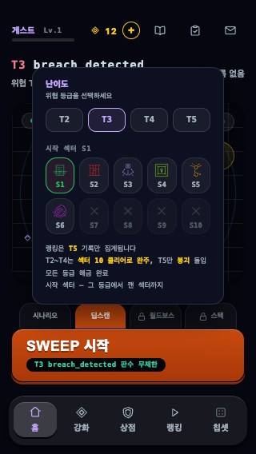

오늘 웹게임의 끝없이 내려가는 모드에 시작 섹터 고르기가 들어갔다. 출발점은 찬이 어제 한 말이었다. 위협 등급을 하나 열 때마다 같은 첫 다섯 섹터를 처음부터 다시 도는데 그게 그냥 반복이라고. 그래서 그 등급에서 이미 깬 섹터까지는 건너뛰고 바로 시작할 수 있게 했다. 처음 보는 섹터는 여전히 직접 지나가야 한다.

앱 쪽은 금방 그림이 나왔다. 이야기 모드에 중간 시작이 이미 있었으니까. 레벨과 무기를 얹어 주는 표를 그대로 빌리고, 칩 줄도 그 화면 것을 다시 썼다. 깬 섹터는 열리고 그 뒤는 잠긴 채로.

걸린 건 서버였다. 랭킹 기록을 받으면 서버는 시간부터 본다. 섹터마다 이 분을 버텨야 보스가 나오니 다섯 섹터를 깼다는 판이라면 적어도 십 분 가까이는 흘렀어야 하고 그보다 짧으면 비정상 기록으로 튕긴다. 여유는 십 퍼센트. 여름에 생긴 줄이다. 부활 횟수를 부풀려 보내면 백 초짜리 판이 정직한 완주보다 위로 가던 구멍이 있었고, 그걸 막느라. 그 옆 주석에는 이 컷을 조였다가 정직한 완주가 튕긴 날짜가 넷 적혀 있다.

여섯 번째 섹터에서 시작한 판은 시계가 영에서 출발한다. 앞의 다섯은 지나가지 않았으니까. 그대로 두면 이 판들은 전부 너무 짧다. 서버 눈에는 다섯 섹터를 깬 척하는 짧은 판과 다를 게 없으니까. 빠른 판을 거짓말로 읽는 규칙은 빨리 갈 정당한 길이 없을 때만 맞는 규칙이었던 셈이다. 길을 내는 순간 그 규칙이 길 위의 사람을 먼저 잡는다.

고친 방식은 받은 시간에 건너뛴 섹터의 게이트 합을 더하는 것. 여섯 번째에서 시작했으면 앞 다섯 몫으로 이 분씩, 십 분을 얹는다. 그러면 처음부터 돈 판과 같은 눈금에 놓이고 검사도 저장도 이 값을 본다. 예전 기록과, 시작 섹터를 아예 안 보내는 구버전 앱의 기록이 같은 보드에 섞여야 해서다.

얹을 값을 무엇으로 할지는 잠깐 고민했다. 게이트 합은 그 구간에서 나올 수 있는 가장 짧은 시간이다. 처음부터 도는 사람은 거기에 보스를 잡는 시간이 더 붙고. 건너뛴 사람이 받는 건 그러니까 바닥값이다. 같은 섹터에서 같이 쓰러지면 처음부터 온 쪽이 조금 위에 선다. 이 보드는 오래 버틴 쪽을 위로 세우니까. 건너뛴 구간은 지나간 걸로는 쳐 준다. 잘 지나간 걸로까지는 안 쳐 주고. 바닥값은 마침 검사하는 줄이 쓰던 그 숫자이기도 했다. 새 숫자를 하나도 만들지 않아도 됐다.

그러고 나니 구멍이 하나 보였다. 시작 섹터는 앱이 보내는 숫자라서 아무 숫자나 보내면 몇 분이 공짜로 붙는다. 그래서 서버도 따로 센다. 그 계정이 최상위 등급에서 실제로 깬 섹터를 기록 옆에 적어 두고, 받아들인 제출마다 올리기만 한다. 그보다 뒤를 시작이라고 대면 튕기고 적힌 게 없으면 첫 섹터만.

이번엔 반대쪽이 걸렸다. 앱도 자기가 깬 섹터를 기기에 적는다. 판을 깼는데 제출이 실패하면 기기 숫자만 앞서 나가고. 앱은 일곱 번째 칩을 열어 주고 서버는 여섯까지만 믿으니 그 칩으로 시작한 정직한 판이 튕긴다. 그래서 로그인 중엔 서버 숫자를 받아 와 둘 중 작은 쪽을 상한으로 쓰게 했다. 열릴 수 있던 칩 하나가 덜 열리는 날은 있겠지만, 열린 칩을 눌렀는데 기록이 튕기는 일은 없게.

저녁에는 등급마다 새 규칙을 하나씩 붙이는 작업이 이어졌다. 같은 섹터를 덜 돌게 했으니 다음은 돌 때마다 뭔가 달라야 해서. 그건 아직 손에 익지 않아 쓸 말이 없다. 첫 섹터에서 시작하는 판은 지금도 똑같은 검사를 받는다. 얹는 값이 영일 뿐이다.
